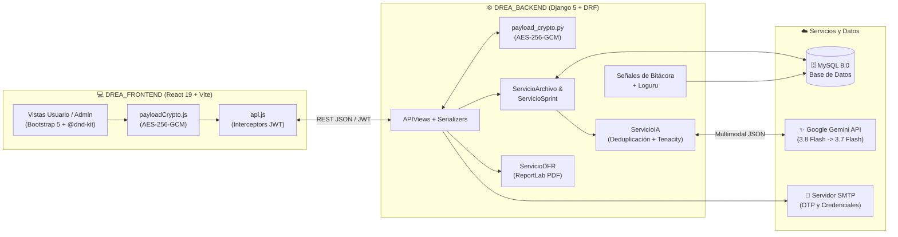
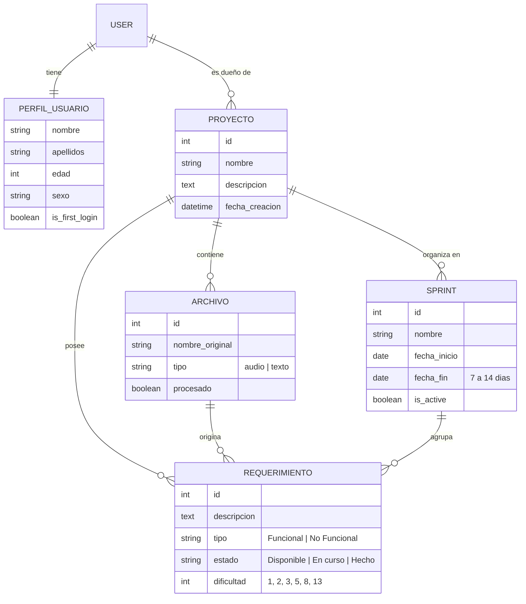

<div align="center">

# 🧠 DREAI — Documentación de Requerimientos y Extracción Automatizada con IA

**Plataforma inteligente para extraer, clasificar, deduplicar y gestionar requerimientos de software desde documentos y audio mediante Google Gemini.**

[](https://www.python.org/)
[](https://www.djangoproject.com/)
[](https://react.dev/)
[](https://vitejs.dev/)
[](https://www.mysql.com/)
[](https://ai.google.dev/)
[](#📐-metodología-de-desarrollo-con-ia)

---

[📋 Brief del Proyecto](./BRIEF.md) · [📘 Documento PRD](./PRD.md) · [🏗️ Arquitectura](#️-arquitectura-del-sistema) · [🚀 Instalación](#-instalación-y-puesta-en-marcha) · [🔐 Seguridad](#-seguridad-y-auditoría)

</div>

---

## 🌟 ¿Qué es DREAI?

**DREAI** (*evolución del proyecto integrador DREA*) es una solución web full-stack diseñada para transformar minutas de reunión, entrevistas grabadas y documentos extensos en un backlog ágil listo para ejecutarse.

En lugar de transcribir y levantar requerimientos manualmente durante horas, el usuario sube archivos de **texto** (`.pdf`, `.docx`, `.txt`) o **audio** (`.mp3`, `.wav`, `.m4a`) y la plataforma:
1. **Extrae y transcribe** el contenido de forma segura (con protección anti *prompt-injection*).
2. **Clasifica** cada requerimiento en **Funcional** o **No Funcional**.
3. **Deduplica semánticamente** contra los requerimientos que ya existen en el proyecto para evitar tareas repetidas.
4. **Estima el esfuerzo** en **Story Points** bajo escala Fibonacci (`1, 2, 3, 5, 8, 13`).
5. **Organiza sprints** en un tablero Kanban interactivo con sincronización cronológica automática.
6. **Exporta el DFR** (*Documento Formal de Requerimientos*) en un PDF ejecutivo generado con ReportLab.

---

## 📂 Entregables de Especificación (Spec-Driven Development)

Este repositorio sigue la metodología **Spec-Driven Development** (*"Escribir antes de construir: Tú diriges, la IA ejecuta"*). Toda la especificación funcional y de producto se encuentra documentada en:

| Fase | Documento | Descripción | Modelo IA Utilizado |
| :--- | :--- | :--- | :--- |
| **Fase 1 · Brief** | [**`BRIEF.md`**](./BRIEF.md) | Resumen ejecutivo en 5 puntos: qué es, para quién, qué **SÍ** hace el MVP, qué **NO** hace todavía, métricas de éxito y preguntas de ajuste. | **Claude Sonnet / Gemini Pro** *(Síntesis y alcance)* |
| **Fase 2 · PRD** | [**`PRD.md`**](./PRD.md) | *Product Requirements Document*: entrevista de Product Manager (8 preguntas), roles, pantallas, modelo de datos, **criterios de aceptación**, riesgos y `[SUPUESTOS]`. | **Gemini Pro / Claude Opus** *(Razonamiento pesado)* |
| **Motor Interno** | `ServicioIA` | Extracción multimodal en tiempo de ejecución desde archivos de texto y audio con salida JSON estructurada. | **Gemini 3.8 Flash** *(Fallback: Gemini 3.7 Flash)* |

> 💡 **Principio aplicado — *"Piensa caro, ejecuta barato"*:** Usamos modelos pesados de razonamiento para definir la arquitectura y el PRD (donde una ambigüedad se multiplica), y modelos ligeros/rápidos (`Flash`) para la ejecución acotada y el procesamiento multimodal en tiempo real.

---

## ✨ Características Principales

### 🤖 1. Extracción Multimodal con IA y Resiliencia
- Soporte nativo para documentos (`.txt`, `.pdf`, `.docx`) y grabaciones de voz (`.mp3`, `.wav`, `.m4a`) de hasta **25 MB**.
- **Deduplicación Semántica:** Envía el contexto de requerimientos existentes a Gemini para extraer únicamente requerimientos nuevos al subir múltiples fuentes.
- **Alta Disponibilidad:** Reintentos automáticos con *backoff* exponencial (5 intentos vía `tenacity` ante errores `429`/`503`) en `gemini-3.8-flash` y caída automática (*fallback*) a `gemini-3.7-flash`.

### 📋 2. Tablero Kanban y Motor Cronológico de Sprints
- Generación automática del **Sprint 1** a partir del backlog extraído.
- Creación de sprints personalizados con validación de negocio (**7 a 14 días**).
- **Sincronización Cronológica Automática (`sincronizar_cronologia`):** Al abrir un proyecto, si el sprint activo ya venció, el sistema lo cierra, crea los sprints consecutivos necesarios hasta la fecha actual y **migra automáticamente los requerimientos pendientes** (`Disponible` y `En curso`) al nuevo sprint activo.
- Tablero drag-and-drop construido con `@dnd-kit`.

### 📄 3. Generación de Reporte DFR en PDF
- Descarga instantánea del **Documento Formal de Requerimientos (DFR)** en formato PDF.
- Incluye portada corporativa, resumen ejecutivo de métricas, tabla general de requerimientos y desglose detallado por sprint y Story Points.

### 🔐 4. Seguridad de Grado Empresarial y Auditoría
- **Cifrado de Payload (AES-256-GCM):** El alta segura de proyectos (`POST /api/proyectos/secure/`) cifra tanto la petición como la respuesta de extremo a extremo entre React (Web Crypto API) y Django (`cryptography`).
- **Protección contra Fuerza Bruta:** Bloqueo automático por 15 minutos tras 5 intentos fallidos de inicio de sesión por combinación `IP + usuario`, con notificación en tiempo real del tiempo restante.
- **Aislamiento Multi-tenant por Usuario:** Cada consulta filtra estrictamente por propietario (`usuario=request.user`), impidiendo accesos cruzados.
- **Bitácora Automática (`BitacoraMovimiento`):** Señales `pre_save`, `post_save` y `post_delete` que registran cada `INSERT`, `UPDATE` y `DELETE` con usuario, IP y valores JSON anteriores/nuevos.

---

## 🏗️ Arquitectura del Sistema



### Módulos del Backend (`DREA_BACKEND`)
| App | Responsabilidad Principal |
| :--- | :--- |
| **`DREA_Core`** | Configuración global, middleware de auditoría por request, cifrado AES-256-GCM, manejador uniforme de excepciones DRF e interceptor Loguru. |
| **`cuentas`** | `PerfilUsuario`, autenticación JWT personalizada, bloqueo por intentos fallidos, recuperación de contraseña por correo (OTP) y CRUD de usuarios para Admin. |
| **`proyectos`** | Modelos `Proyecto`, `Archivo` y `Sprint`, además de la lógica de negocio en `ServicioArchivo` y `ServicioSprint`. |
| **`requerimientos`** | Modelo `Requerimiento` (clasificación, estado Kanban, Story Points y metadatos de IA). |
| **`procesamiento_ia`** | `ServicioIA` (extracción de texto con `pypdf`/`python-docx`, audio nativo, prompts anti-inyección y normalización Fibonacci). |
| **`reportes`** | `ServicioDFR` para construcción de reportes ejecutivos en PDF con `ReportLab`. |
| **`bitacora`** | Modelo `BitacoraMovimiento` y registro automático de señales de auditoría en toda la base de datos. |

---

## 🗄️ Modelo de Datos Principal



---

## 🚀 Instalación y Puesta en Marcha

### 1. Requisitos Previos
- **Python** `3.12+`
- **Node.js** `18+` (recomendado `20+`)
- **MySQL** `8.0+` activo
- **API Key de Google Gemini** ([Google AI Studio](https://aistudio.google.com/))

### 2. Crear la Base de Datos en MySQL
```sql
CREATE DATABASE DREA CHARACTER SET utf8mb4 COLLATE utf8mb4_unicode_ci;
```

### 3. Configurar y Levantar el Backend (`DREA_BACKEND`)
```bash
cd DREA_BACKEND

# Crear y activar entorno virtual (Windows)
py -3.12 -m venv venv
venv\Scripts\activate

# Instalar dependencias
pip install -r requirements.txt

# Crear archivo de variables de entorno
copy .env.example .env
```

Edita el archivo `.env` del backend con tus credenciales (asegúrate de que `PAYLOAD_AES_KEY` sea una clave Base64URL de 32 bytes idéntica a la del frontend):
```env
SECRET_KEY=tu_secret_key
DEBUG=True
ALLOWED_HOSTS=localhost,127.0.0.1
DB_NAME=DREA
DB_USER=root
DB_PASSWORD=root
DB_HOST=localhost
DB_PORT=3306
GEMINI_API_KEY=tu_gemini_api_key
PAYLOAD_AES_KEY=tu_clave_base64_32_bytes
```

Genera las migraciones, aplícalas y levanta el servidor:
```bash
python manage.py makemigrations
python manage.py migrate
python manage.py createsuperuser
python manage.py runserver
```
> El backend quedará disponible en `http://127.0.0.1:8000`.

### 4. Configurar y Levantar el Frontend (`DREA_FRONTEND`)
```bash
cd DREA_FRONTEND

# Copiar plantilla de entorno y colocar la misma clave AES
copy .env.example .env
```
En `DREA_FRONTEND/.env`:
```env
VITE_PAYLOAD_AES_KEY=tu_clave_base64_32_bytes
```

Instala los paquetes y arranca el servidor de desarrollo:
```bash
npm install
npm run dev
```
> El frontend quedará disponible en `http://localhost:5173`.

---

## 🧭 Mapa de Rutas (Frontend)

| Tipo de Acceso | Ruta | Vista / Funcionalidad |
| :--- | :--- | :--- |
| **Público** | `/login`, `/registro`, `/recuperar-contrasena` | Inicio de sesión JWT, registro con validaciones en vivo y recuperación OTP. |
| **Usuario Normal** | `/dashboard` | Métricas ejecutivas de proyectos, requerimientos y Story Points. |
| **Usuario Normal** | `/proyectos`, `/proyectos/nuevo`, `/proyectos/:id/editar` | Gestión de proyectos con cifrado de payload `AES-256-GCM`. |
| **Usuario Normal** | `/proyectos/:id` | Centro de control del proyecto, archivos, sprints y descarga del PDF DFR. |
| **Usuario Normal** | `/proyectos/:id/subir-archivo` | Subida y procesamiento multimodal con IA. |
| **Usuario Normal** | `/proyectos/:id/requerimientos` | Tabla maestra filtrable de requerimientos extraídos. |
| **Usuario Normal** | `/proyectos/:id/tablero`, `/proyectos/:id/crear-sprint` | Tablero Kanban interactivo y creación de sprints. |
| **Administrador** | `/admin/dashboard`, `/admin/usuarios`, `/admin/bitacora` | Gestión de cuentas de usuario y auditoría de movimientos en BD. |

---

## 📏 Convenciones del Equipo

- **Flujo de Ramas (Git Flow):** `feature/<tema>` $\rightarrow$ `develop` $\rightarrow$ `release/vX.Y` $\rightarrow$ `main`.
- **Commits Convencionales en Español:**
  - `feat:` nueva característica
  - `fix:` corrección de error
  - `docs:` cambios en documentación (`BRIEF.md`, `PRD.md`, `README.md`, `AGENTS.md`)
  - `chore:` tareas de mantenimiento o configuración
- **Idioma del Código:** Todo el dominio, modelos, variables y mensajes de respuesta se mantienen en **español**.

---

<div align="center">

Desarrollado bajo la metodología **Spec-Driven Development** · Proyecto Integrador **DREA / DREAI**

</div>
